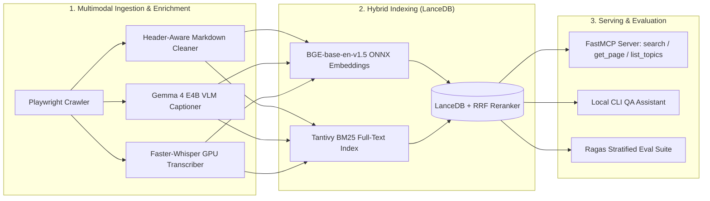

# Multimodal Local RAG & MCP Documentation Server

A fully local, privacy-preserving **Multimodal Retrieval-Augmented Generation (RAG)** pipeline and **Model Context Protocol (`FastMCP`)** server for technical documentation. It ingests heterogeneous documentation—structured **Markdown**, **diagrams/UI screenshots**, and **embedded tutorial videos**—into a unified **LanceDB** hybrid search index (`Dense Vector + BM25 + Reciprocal Rank Fusion`) and exposes grounded retrieval tools directly to AI coding agents.

---

## Architecture



---

## Benchmark Results (19-Query Stratified Multimodal Suite)

Evaluated across `markdown_text`, `image_caption`, and `video_transcript` queries using deterministic retrieval metrics and **Ragas** LLM-as-a-Judge scoring:

| Modality | Recall@5 | MRR | Ragas Faithfulness | Ragas Context Recall |
| :--- | :---: | :---: | :---: | :---: |
| **Markdown Text** | 100.0% (9/9) | 1.000 | — | — |
| **Image Captions (Gemma 4 VLM)** | 100.0% (5/5) | 1.000 | — | — |
| **Video Transcripts (Faster-Whisper)** | 100.0% (5/5) | 0.867 | — | — |
| **Overall** | **100.0% (19/19)** | **0.965** | **0.995** | **0.947** |

---

## Key Engineering Decisions

* **VLM Captioning + Hybrid BM25 over Raw Patch Embeddings:** Technical documentation screenshots frequently contain exact CLI flags, configuration keys, and numeric tolerances. Converting diagrams and UI captures into structured descriptions via a local **Gemma 4 E4B** VLM allows **Tantivy BM25** + **BGE dense vectors** (`RRFReranker`) to match both exact keywords and semantic intent.
* **Three-Tier MCP Tool Surface (`FastMCP`):** Exposing `list_project_insight_topics()`, `get_project_insight_page(path)`, and `search_project_insight_docs(query, top_k)` prevents IDE agents from wasting turns on repeated exploratory searches when they need a complete specification page.
* **100% Local Execution:** All inference (`llama.cpp` + Gemma 4), embeddings (`FastEmbed` ONNX), transcription (`faster-whisper`), and storage (`LanceDB`) run locally with zero external API dependencies.

---

## Project Structure

```text
multimodal-doc-rag-mcp/
├── .env.example
├── .gitignore
├── pyproject.toml
├── README.md
├── src/
│   └── multimodal_rag/
│       ├── __init__.py
│       ├── config.py          # Environment-driven paths & model settings
│       ├── scraper.py         # Playwright crawler & HTML-to-Markdown extractor
│       ├── enricher.py        # Markdown cleaner, VLM captioner, & Whisper transcriber
│       ├── indexer.py         # Hierarchical chunker & LanceDB hybrid index builder
│       ├── retriever.py       # Hybrid Vector + BM25 + RRF search wrapper
│       ├── chat.py            # Local CLI Q&A runner with source citations
│       └── mcp_server.py      # FastMCP server for IDE coding agents
└── evals/
    ├── generate_dataset.py    # Stratified multimodal evaluation dataset builder
    ├── evaluate_rag.py        # Recall@K, MRR, and Ragas benchmark runner
    └── sample_golden_set.json # Example evaluation schema
```

---

## Quickstart

### 1. Install Dependencies
```bash
uv sync
cp .env.example .env
```

### 2. Run Ingestion, Enrichment & Indexing
Start your local OpenAI-compatible VLM/LLM server (e.g., `llama-server` serving `Gemma 4 E4B` on `[http://127.0.0.1:8080/v1](http://127.0.0.1:8080/v1)`), then run:
```bash
uv run python -m multimodal_rag.scraper
uv run python -m multimodal_rag.enricher
uv run python -m multimodal_rag.indexer
```

### 3. Connect to an IDE Agent via MCP
Add the server to your IDE's `mcp_config.json`:
```json
{
  "mcpServers": {
    "multimodal-doc-rag": {
      "command": "uv",
      "args": ["run", "--quiet", "src/multimodal_rag/mcp_server.py"],
      "env": {
        "PYTHONUTF8": "1"
      }
    }
  }
}
```

### 4. Interactive CLI & Evaluation Suite
```bash
# Interactive terminal Q&A with source citations
uv run python -m multimodal_rag.chat

# Run stratified retrieval + Ragas benchmark
uv sync --extra eval
uv run python evals/evaluate_rag.py
```